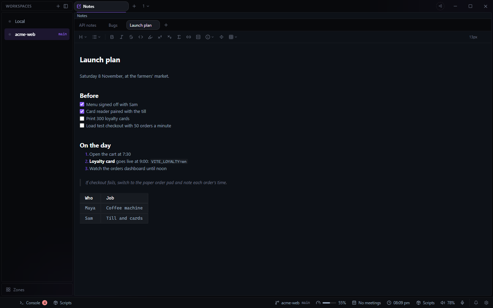

# Notes for Deck

Markdown notes for each project, in a pane beside your terminals. Open it from the **+** beside
your tabs, or a pane's menu, and choose **Notes**.

- Each workspace folder has its own notes; a workspace on your home folder uses **General**.
- **+** after the last tab makes a note; double-click a tab to rename it; the X deletes it, after
  asking. Drag a tab to reorder; the order is kept per project on this machine.
- The editor shows the Markdown formatted as you write, with a formatting bar above it. Ctrl +
  wheel changes the text size.
- Paste an image and it is saved beside the note and shown in it.
- Notes save as you type.

A note is one `.md` file named after its title, in Deck's config folder
(`%APPDATA%\Deck\data\notes\<project>\`), so any Markdown editor can open them and a Deck backup
carries them. Notes written when Notes was built into Deck (until 1.1) are moved there and show
up as soon as the plugin is installed.
